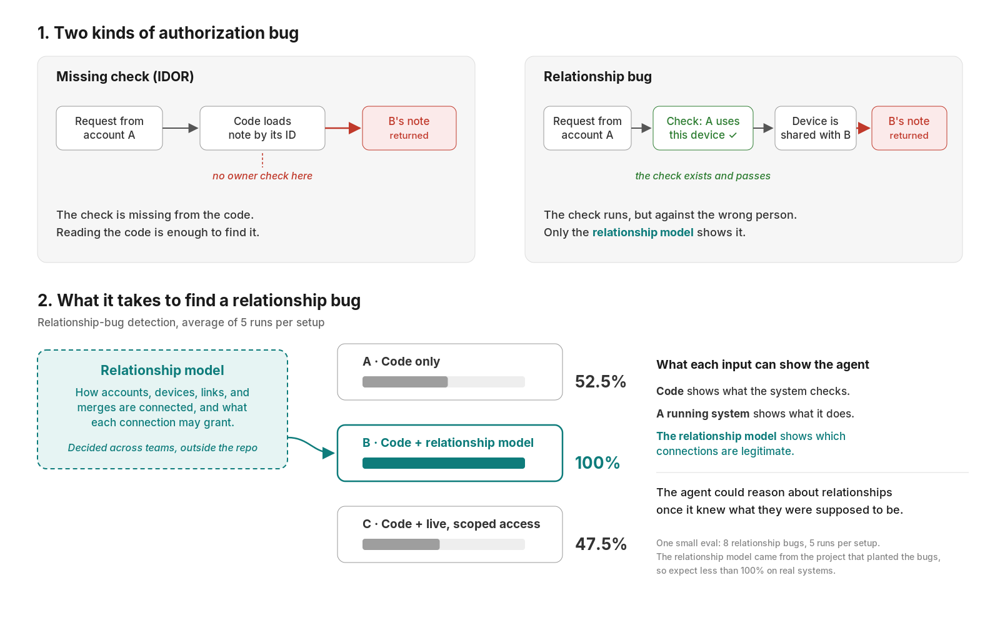
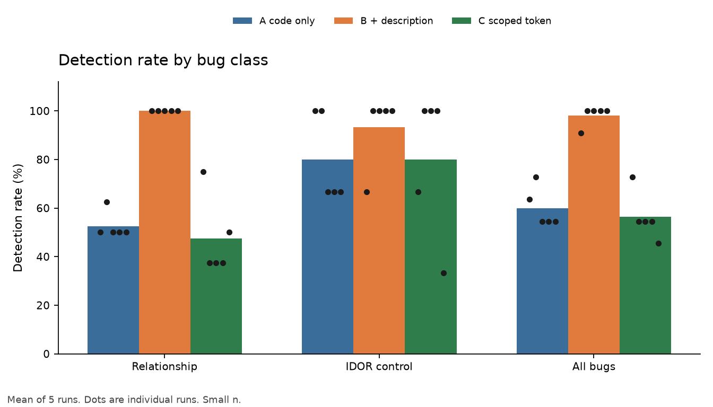

### The hypothesis

When Cloudflare published its [security-audit skill](https://github.com/cloudflare/security-audit-skill) on X, I replied with the class of bugs that I’ve seen are hard to uncover and fix: "*In identity systems the worst bugs are often not a missing auth check but a shared device or account link that can resolve to the wrong person. The agent needs to know how accounts relate, not just the routes.*"

In an era where agents write most of the code, type checkers and test suites catch the easy failures. Semantic bugs get through them, because well-typed, well-tested code can still be wrong. Some semantic bugs are easy to spot, like a missing check: the code fetches a record by its ID and never checks whether it belongs to the person asking. Once you know these types of mistakes, you can write tests and evals for them.

A relationship bug is harder to see, because it comes from how the system connects things. The code does check whether the record belongs to the person asking. But a device two people share or a merge of two accounts into one can make it resolve the wrong person. Someone ends up with access they shouldn’t have or looking at someone else’s data, and unlike the latest outages at [Microsoft](https://www.theguardian.com/technology/2026/nov/16/microsoft-global-outage-cause), [banks](https://apnews.com/article/bank-outage-chase-wells-fargo-truist-zelle-aeb4b0d6b6789c8c96bb2520454a6d1e) and the [FAA](https://www.faa.gov/newsroom/nationwide-ground-stop-questions-and-answers), nothing breaks or fires loudly enough for anyone to notice.

Your system might be hiding a bug like this. Say you install a security audit skill. You want to know if it will catch the bugs you know are possible in identity systems. That is what I set out to test: when an audit agent misses that kind of bug, is it because it can't reason about relationships, or because nobody told it how the accounts are supposed to relate? And if the agent can send requests to a running system, can it learn how the accounts relate by watching what the system does?

### The eval

I asked Grok to build a small Python repo that measures how well an audit agent finds authorization bugs, where one account can read or change another account's data. These are called broken object-level authorization (BOLA) or insecure direct object reference (IDOR). The application is a FastAPI and SQLite account directory with accounts, sessions, devices, account links, and merges. It has 11 planted bugs, and each one lets one account reach another account's data. Three are plain IDOR bugs, each missing an ownership check, as a control group. The other eight are relationship bugs; the ownership check is there, but a shared device, account link, or merge makes it check against the wrong account. Each bug comes with an exploit test that runs against the live app. The exploit works on the buggy version and fails once the bug is fixed, which confirms every planted bug is real and exploitable.

The audit agent ran Cloudflare's skill in its quick mode, with five fresh runs for each setup:

* A: source code only.
* B: source code plus the relationship model: a short note on how accounts, devices, links, and merges are connected and what each connection may grant, written as rules, not as a list of bugs.
* C: source code plus access to the running app as one account, using a read-only token that expires in 15 minutes. A proxy logs every request and blocks anything that account isn't allowed to see.

### Results

Share of planted bugs found, averaged over five runs. The number in parentheses shows how much the runs varied:

| Bug class | A: code only | B: code + relationship model | C: code + live, scoped access |
| :---- | :---- | :---- | :---- |
| Relationship bugs (8) | 52.5% (5.6) | 100% (0) | 47.5% (16.3) |
| IDOR controls (3) | 80.0% (18.3) | 93.3% (14.9) | 80.0% (29.8) |
| All bugs (11) | 60.0% (8.1) | 98.2% (4.1) | 56.4% (10.0) |

Two bugs show the gap most clearly. Code alone never caught the bug where a shared device shows one person's notes to the other, or the one where a merge let the surviving account inherit access granted to the account it absorbed (0 of 5 runs each). With the relationship model, the agent caught both in 5 of 5.

***You can spot a missing check by reading the code. A relationship bug is harder: the code looks correct unless you know how the accounts are supposed to relate.***

Live access didn't close the gap. Setup C scored about the same as code alone. It wasn’t for lack of trying: in 3 of 5 runs the agent requested data its token wasn’t allowed to read, 24 in total, and the proxy blocked all of them.

### Caveats

* Five runs per setup.
* The same project planted the bugs, wrote the relationship model, and graded the findings.
* The rules for counting a finding as a hit on a planted bug were narrowed after the runs. Under the original rules, code alone found 70% of relationship bugs, and code + the relationship model found 100%.
* Isolation relied on instructions to the agent, not an operating-system sandbox.
* The same agent double-checked its own findings. No separate reviewer did.
* Findings that matched no planted bug (4 of 33 in A, 1 of 50 in B, 3 of 31 in C) may describe one in different words. They aren't proven false positives.

### What was missing

The agent could reason about relationships once it knew what they were supposed to be. With the relationship model, detection of relationship bugs went from 52.5% to 100% on the same code, with the same skill. With live, scoped access instead, it was 47.5%, very close to what code alone yielded. Running code can show what the system does, but not what it should do. Only the relationship model says which connections are legitimate.

That changes how audit agents should be evaluated. In enterprise organizations, how accounts, devices, and services relate is decided across teams, and those decisions mostly live outside any one repo. If an eval gives the agent only the code, a low score looks like the agent can’t reason about relationships, when the context it needed was never in the code. ***Evals need to include the relationship model, written down where the agent can read it.***

One caution: the relationship model here came from the same project that planted the bugs. Real teams’ notes will have gaps, so expect less than 100%. What the eval does show is where the improvement comes from: someone has to own how things are connected and write it down. Making those connections explicit across teams is what my article [Team Programming Interface](https://mlescaille.com/writing/team-programming-interface/) is about, because an agent can only check what was written down.

This is one small eval. The code, exploit tests, and raw results are in the repository: [https://github.com/mlescaille/authz-agent-evals](https://github.com/mlescaille/authz-agent-evals).
