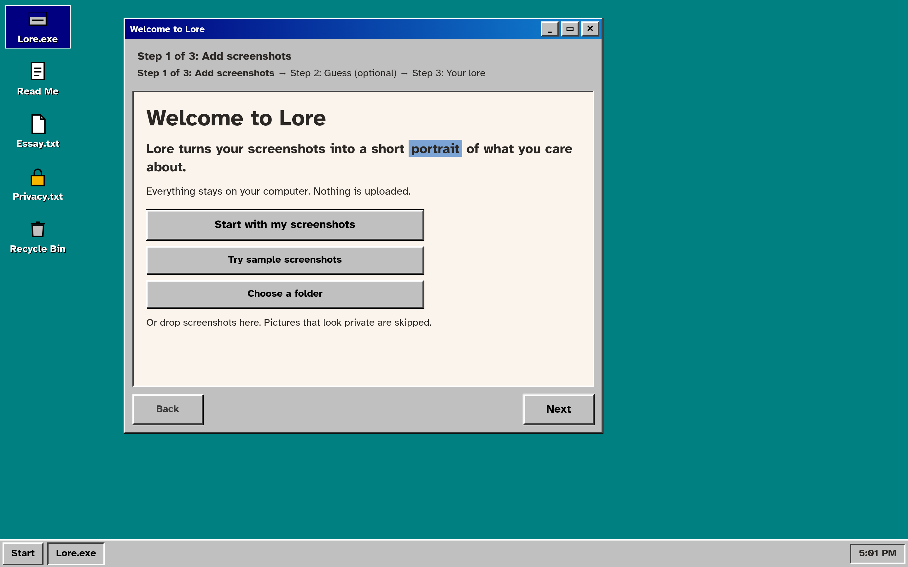

I was looking through an analysis of my photo library and noticing how many of the pictures were not pictures but screenshots. I keep recipes, quotes, you name it. Things that call my attention. That is when I wondered: oh, where is my mind in this?

I had already been reading other piles of my own record of notes, published writing, an old tweet archive as one corpus. The photo roll was supposed to be the life I meant to remember. Instead it was full of holds on thoughts I did not want to lose. Not a gallery so much as a trail of attention.

That is where the autobiography idea came from. From noticing that a screenshot roll is already a kind of life corpus: dinners meant to be cooked, trips meant to be taken and remembered, messages, runs, celebrations, lines that landed, figures from a meeting. Line enough of them up and a shape shows. What you claim in conversation is one version. What your screenshots keep is quieter, and often closer to where your mind actually went.

***What we screenshot is the autobiography we never meant to write.***

Most of the time that archive just sits there. You know it is yours. You do not read it. Reading your own screenshots in bulk feels slightly ridiculous. So the autobiography stays unopened, even though you have been writing it in the background for years.

Lore is the small tool that came out of that question. An essay that makes the argument, paired with something you can run. You drop in screenshots, you can guess the three themes you think you save most, and it shows a short portrait of what you actually kept. Whatever pattern is really there shown in a fun, retro style.

Lore's homepage.

Everything that touches your pictures stays on your device. Nothing is uploaded. There is no account. The page never sends your screenshot bytes, the text it reads, or your guesses to a server. If a small model needs to download once so it can run locally, that is the only traffic, and the sample set does not need it. Forget deletes the reading. Your original files stay where they were.

Screenshots are intimate in a way photos sometimes are not. They catch the half-finished thought and the private plan. A tool that reads them should not ask you to trust a cloud with that. Lore does not.

The portrait is short on purpose. Theme names, counts, a stretch of time, a one-line title. Not the words from inside a screenshot, and not the pictures themselves. Enough to recognize yourself. Not enough to hand a stranger your camera roll.

I keep thinking about how much of a life now lives in these accidental saves. We used to underline books and tear recipes out of magazines. The screenshot is that same instinct with a worse filing system. Lore is not trying to organize your life. It is trying to read the filing system back to you, once, so you can see what you have been quietly collecting.

One natural extension is your shots over time: not only who you are in this roll, but how what you screenshot shifts across years. That is still an idea, not something Lore does yet. Even the thought of it makes the archive feel less like clutter and more like a diary you forgot you were keeping.

If you want to see what your own archive has been saying, try [Lore](https://mlescaille.com/lore). Discover your lore.
