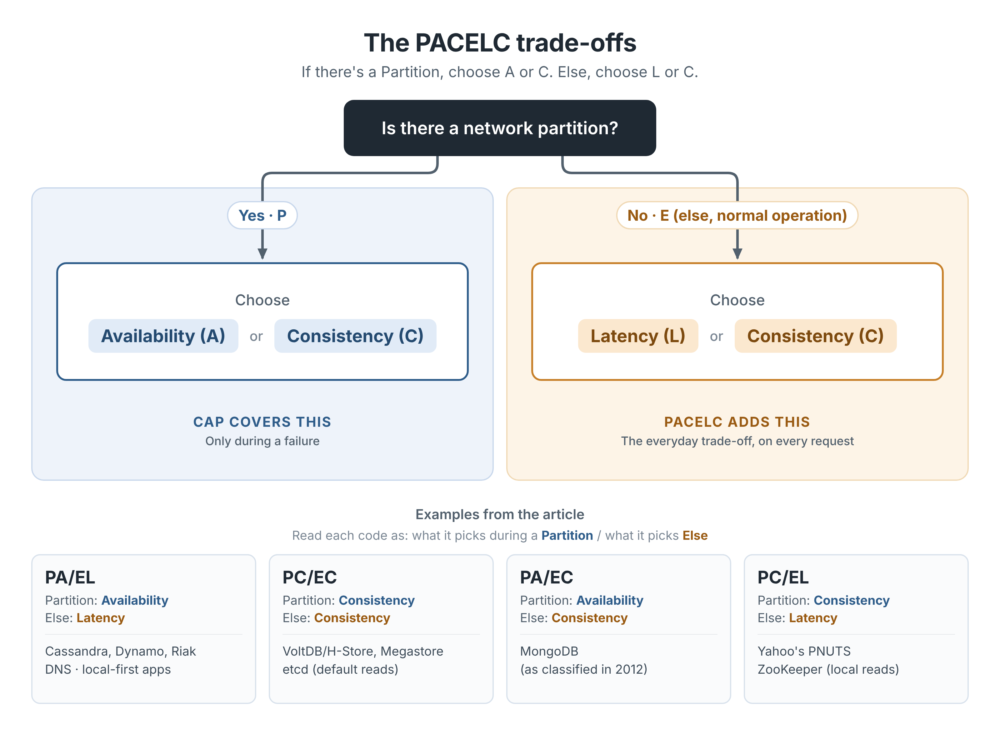

> "When we try to pick out anything by itself, we find it hitched to everything else in the Universe." — John Muir

The CAP theorem tells us that when a network partition happens, a distributed system has to choose between availability and consistency. It's a useful lens, but it only describes what happens when the network breaks. Partitions are real, but they are not the normal state of things. Most of the time the network is fine, and your system is still making a trade-off on every single request. That gap is what PACELC fills.

### Where PACELC comes from

PACELC was proposed by Daniel Abadi, a computer science professor, first in a 2010 blog post and then in a 2012 paper in *IEEE Computer*, "Consistency Tradeoffs in Modern Distributed Database System Design." His argument was simple: CAP describes behavior during failure, but the design decisions that shape everyday performance happen when nothing is failing at all.

The paper used databases as its examples. The idea itself travels much further.

### Reading PACELC as a sentence

PACELC reads like a sentence, which is part of why it sticks:

- **If there is a Partition (P)**, the system chooses between **Availability (A)** and **Consistency (C)**.
- **Else (E)**, when the system is running normally, it chooses between **Latency (L)** and **Consistency (C)**.

The first half is CAP. The second half is the insight. Even with a perfectly healthy network, keeping replicas in agreement means waiting for them to agree, and waiting costs time. If you want fast responses, you accept that some copies may briefly be behind.

***A partition is an event. The latency versus consistency choice is a constant.***

PACELC in one picture: CAP only covers what happens during a partition, but the latency-versus-consistency trade-off applies to every request.

### The same trade-off, hitched to everything else

Once you start looking for the "else" branch, it shows up everywhere state is replicated.

#### Coordination services: ZooKeeper, etcd, Consul

These are the systems we trust to tell us who the leader is, which config is current, or who holds a lock. They lean hard toward consistency when the network splits: writes need a quorum, so the minority side of a partition stops accepting them rather than diverging.

The "else" branch is still there, and you can see it in their read paths:

- **ZooKeeper** serves reads from whichever server a client is connected to, which is fast but can be slightly behind the leader. If you need the latest value, you call `sync()` first and pay for it.
- **etcd** gives you linearizable reads by default, and offers serializable reads when you are willing to trade freshness for latency.
- **Consul** lets you pick per request between `default`, `consistent`, and `stale` consistency modes.

Same service, same healthy network, different answers depending on how long you are willing to wait.

#### Distributed caches

A cache is a latency decision by definition. You keep a copy of data closer to the reader so you don't have to go back to the source of truth. A TTL is an explicit statement of how stale you are willing to be. Replication inside the cache makes the same choice again: Redis replicates asynchronously by default, so a replica can briefly serve an older value, and if you want stronger guarantees you wait for acknowledgments and pay in latency.

#### DNS

DNS might be the largest eventually consistent system most of us depend on. Records are cached at every layer with a TTL, and a change takes time to propagate. That is a deliberate design: lookups are fast and keep working when an authoritative server is unreachable, in exchange for the world being temporarily out of date after an update. Anyone who has waited for a DNS change to "take" has lived on the EL side of PACELC.

#### Message queues and logs

In Kafka, the producer setting `acks` is the PACELC dial in a single config line. `acks=1` returns as soon as the leader has the write; `acks=all`, combined with `min.insync.replicas`, waits for the in-sync replicas and gives you stronger durability at the cost of latency. During failures, `unclean.leader.election.enable` decides whether an out-of-sync replica can become leader: availability now, at the risk of losing messages.

#### Distributed file systems

File systems that span machines make the same trade-off around metadata and caching. HDFS, for example, keeps namespace metadata on a single active NameNode so there is one authoritative view of the file system. Client-side caching in network file systems like NFS trades strict freshness for speed, which is why another client may not see your write until you close the file or a cache expires.

#### Collaborative and sync apps

Shared docs, notes apps, and anything "local-first" make the clearest PA/EL choice of all. You keep typing on a plane with no connection, and your edits merge later. Even with a perfect connection, your keystrokes show up on your screen before anyone else's copy has them. Techniques like operational transformation and CRDTs let the system accept writes everywhere and stay responsive, with a promise that every copy eventually converges to the same document. That's a weaker guarantee than the C in PACELC, and it's exactly the trade these apps choose to make.

#### And yes, databases

Abadi's paper classified the database systems of the time, and those labels still help:

| System (as described in the 2012 paper) | Partition | Else |
| --- | --- | --- |
| Dynamo, Cassandra, Riak | Availability | Latency |
| VoltDB/H-Store, Megastore | Consistency | Consistency |
| MongoDB | Availability | Consistency |
| Yahoo's PNUTS | Consistency | Latency |

Two caveats. These classifications reflect the systems as they behaved around 2012, and many have changed since. And many modern systems let you tune consistency per request, for example by choosing how many replicas must acknowledge a read or a write. In those systems PACELC is less a label and more a dial you set, which brings us back to the pattern above: ZooKeeper's `sync()`, Consul's modes, Kafka's `acks`. Same dial, different nameplates.

### Two questions instead of one

When I look at any system with replicated state, whether I am designing it, configuring it, or debugging it at an inconvenient hour, I try to ask two questions instead of one:

1. **If the network splits**, do I keep serving requests, or refuse rather than diverge?
2. **On a normal day**, do I answer fastest, or answer freshest?

A social feed, a product catalog, or a DNS record can usually tolerate a little staleness in exchange for speed. A bank balance, an inventory count, or a lock that decides which node is leader usually cannot. The honest answer is often different for different parts of the same product, and that is fine. The mistake is not choosing; the mistake is choosing by default.

### The constant underneath

CAP tells you what breaks during a failure. PACELC reminds you that the trade-off between speed and correctness never goes away. It is part of every request your system serves, whether that system is a database, a cache, a broker, or the doc open in another tab.

What I like most about PACELC is the same thing I like about any good principle: once it clicks, you start seeing it hitched to everything else. Where have you seen the "else" branch show up in your systems?

*Ps: If you find a system on this list that has changed its defaults since I wrote this, I would love to hear about it. Distributed systems have a way of making every snapshot slightly stale. Fittingly.*
