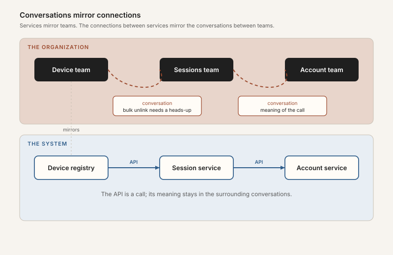
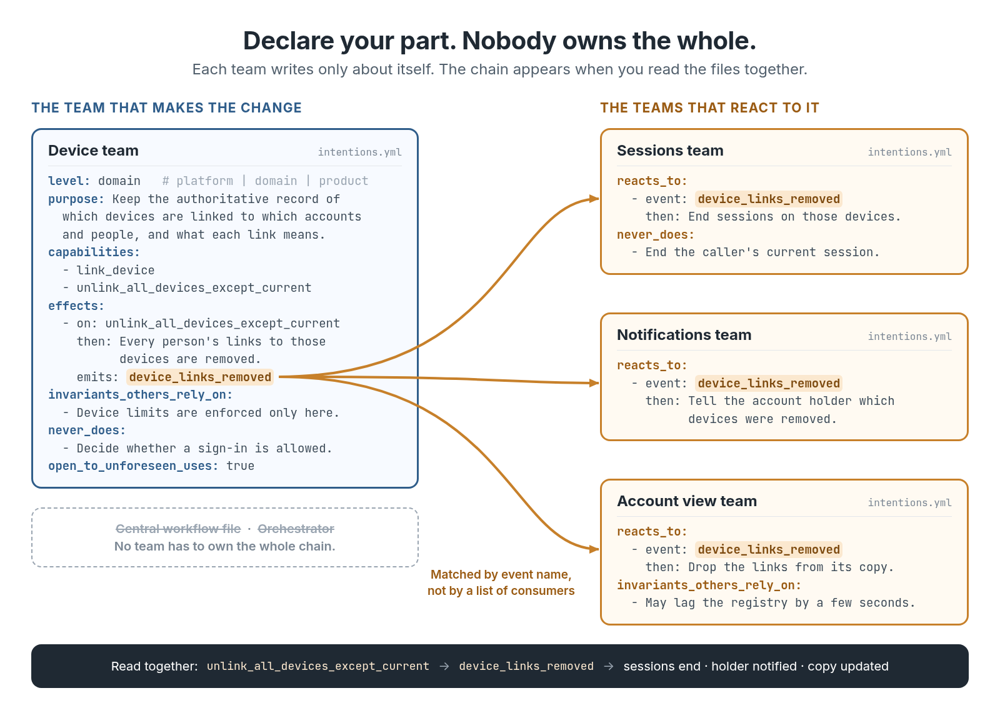
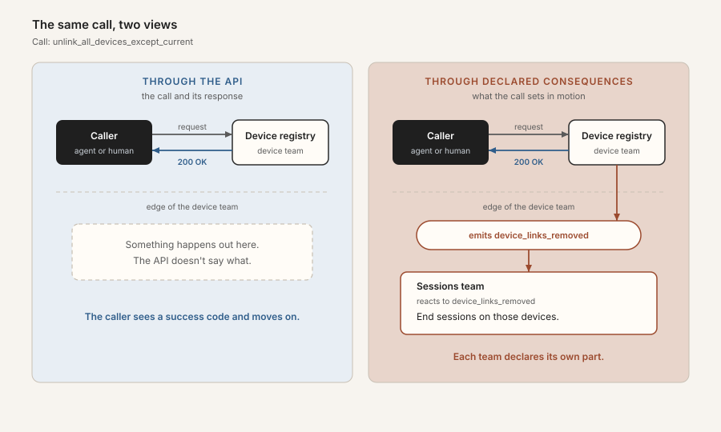

In 1968, [Melvin Conway](https://www.melconway.com/Home/Conways_Law.html) made an observation that has outlived almost every technology of its time: *"Any organization that designs a system (defined broadly) will produce a design whose structure is a copy of the organization's communication structure."*

For decades, [Conway's Law](https://www.melconway.com/Home/Conways_Law.html) was mostly read as a warning.

Microservices shifted this warning. Instead of fighting Conway's Law, they lean into it: split the system along the lines where teams already divide the work, give each team a service it can build, deploy, and change on its own, and let the architecture mirror the organization on purpose. When [James Lewis and Martin Fowler](https://www.martinfowler.com/articles/microservices.html) described [microservices](https://martinfowler.com/articles/microservices.html) in 2014, one of the core traits was organizing services around business capabilities, and around the teams that own them. The deliberate version of this, the *inverse Conway maneuver*, was named by [Jonny LeRoy and Matt Simons](https://martinfowler.com/bliki/ConwaysLaw.html) in 2010 and later popularized by *Team Topologies*: ***shape the teams you want***, and the architecture follows.

So a service boundary is also a team boundary. It marks where knowledge, authority, and responsibility have been divided.

Conway's Law has a second half that is easier to miss. If the services mirror the teams, then the connections *between* services mirror the communication *between* teams. Conway's own argument was about those lines. If two parts of a system are connected, he wrote, the groups that designed them ["must have negotiated and agreed upon an interface specification."](https://www.melconway.com/Home/Committees_Paper.html) The specification captured the call. It rarely captured what the two groups agreed the call *meant*, and that is where the important knowledge lives in enterprises today.



*Conversations between teams mirror connections between services. The API is a call; its meaning stays in the surrounding conversations.*

### APIs are not enough

This is intuitively known if you work in enterprises. An API describes actions. It tells you what you can ask a service to do, what to send, and what you will get back. It is a precise and useful contract, and it stops at the end of the service call. Its job is done when the API replies with a success or an error.

Beyond that boundary, take, for example, a call to *unlink all devices on this account, except the current one*. The API signature for it is small. However, the side effects can be significant. Every person on the account loses access on those devices. Sessions have to end. Perhaps some page will now show an updated sessions list. Other teams need to know or at least their systems need to know, and any offline copy of device links has to catch up, or it will differ from the source of truth.

Today, humans carry that knowledge: which changes ripple where, which team needs a heads-up before a bulk operation, which rule another team silently relies on. Work slows when the only way to find out what a change will touch is to know the right person.

**Agents make the gap harder to ignore.**

Agents are built for tool use and text: they choose tools, fill arguments from unstructured context, and parse or summarize the replies to decide the next step. Protocols like MCP make those tools addressable across services. None of that tells the agent what a successful call means for other teams. The tool result says whether this service accepted the request; the consequences that decide whether the organization got the outcome it wanted still live outside the call.

### New boundaries, new interfaces

A *Team Programming Interface* describes the consequences of a team's capabilities across team boundaries: what changes beyond the API calls, and when, as you use it. By *team* I mean the group of services and people responsible for one part of an organization's software delivery.

*Team Topologies* introduced the [Team API](https://github.com/TeamTopologies/Team-API-template) to make a team's purpose, ownership, and preferred interactions visible to other teams. The Team Programming Interface takes the idea in a different direction. Instead of describing how to work with a team, it describes what a team's capabilities *do* to the rest of the organization, in a form both people and agents can read.

That raises an architectural question: how do you make those consequences explicit without undoing the boundaries that microservices gave us?

A Team Programming Interface is what a team states about itself, and only itself:

| Element | The question it answers | For a device registry |
| --- | --- | --- |
| Authority | What is the team the source of truth for? | Device links to accounts and people. |
| Effects | What changes beyond the call, and what gets announced? | Unlinking removes everyone's links and announces it. |
| Guarantees | What can others build on? | Device limits are enforced here, and only here. |
| Limits | What will the team never do, and callers never do? | Never decide sign-ins. Callers never edit a copy. |
| Openness | How freely can it be used for unplanned things? | Open, within the guarantees. |
| Ask first | When should a caller check with a human? | A change touches many accounts. |

Guarantees need a scope: reads from the registry are current, copies catch up later. That is the team's [consistency trade-off](https://mlescaille.com/writing/pacelc-beyond-cap/), in the open. Removing an effect others rely on is a breaking change.

How open a team is depends on its level:

- **Platform and foundational services**, like identity or accounts, are used in ways their owners will never see. They should be precise about effects and guarantees, and deliberately open about uses.
- **Domain services**, like the device registry, own the truth for one area. They should be strict about what they own, and open about who uses it.
- **Product services** sit closer to a particular outcome. They can be more specific about what they expect to happen before them, and when callers should ask first.

In every case, callers keep the freedom to use a capability however it fits best.

### Consequences, not calls

The device team says "unlinking removes every person's links and announces it." It doesn't say "and then the session team must revoke tokens." The team that owns session data declares, on its own side, what it does when that announcement arrives. Nobody writes down the whole chain. It emerges when the agent reads the declarations together.

In distributed-systems terms, this is choreography, with the usually invisible flow made readable, and still nobody in charge of it. This allows for organizational and agentic decoupling.

That answers the boundary question. A contract that names its downstream systems couples a team to every consumer it has ever had. A contract that describes its effects lets consumers come and go without negotiation.

### Keeping it honest

Declarations nobody checks become the next layer of tacit architecture: what the system was designed to do, not what it does. Whatever form they take, they have to be checkable. Declared announcements show up on the bus. Declared reactions can be compared with real subscriptions, so an undeclared consumer stands out. Guarantees become the consumers' tests, run in the owner's build, the way consumer-driven contracts already work. The declarations aren't trusted. They're verified.

### Example definition

The concept doesn't depend on a format. A team could use a README section, a [Backstage](https://backstage.io/) catalog entry, an [EventCatalog](https://www.eventcatalog.dev/) or AsyncAPI document, [Pact](https://pact.io/) contract tests, or whatever fits how it already works. What matters is that the owner declares the consequences, and that people and agents can read them.

My own version started with a file I called `intentions.yml`, a place beside the code where humans tell agents what the work is *intended* to do. Here is roughly what it looks like, as an illustration rather than a schema to adopt:

```yaml
# intentions.yml (device registry)
effects:
  - on: unlink_all_devices_except_current
    then: Every person's links to those devices are removed.
    emits: device_links_removed

# intentions.yml (sessions)
reacts_to:
  - event: device_links_removed
    then: End sessions on those devices.
```



*Illustrative, in one possible format.*

### It is an agentic world

Going back to the agent that got a successful tool result and moved on.

Now the same agent can read, before acting, what the call sets in motion, which guarantee it must not break, and when to stop and ask a human. Blast radius belongs to the whole chain, so it follows reactions until nothing new is announced. Declarations inform; they don't authorize. Whether it may make the call is still a policy decision.

[Anthropic's AI-native SDLC playbook](https://claude.com/resources/articles/the-ai-native-sdlc-playbook) describes a loop where every stage commits a file the next stage reads: an intent.md for what someone wants, then a spec, a plan, the diff, the review. It's a good chain, but it follows one change inside one team. The intent.md has a line for "affected users and systems," and whoever writes it fills that in from what they happen to know. The declarations are where that line could come from. Anthropic's intent.md describes what a change is for; a team's declarations, for example `intentions.yml`, say what a capability does to everyone else.

After acting, it has something to check against. Are sessions on those devices actually gone? If not, either a declaration is wrong or something failed downstream. Both beat "the agent did something weird."

Larger outcomes come out of this too. Setting up a new device might mean resolving the account, then the user, adding the device through authentication claims, asking for a one-time passcode, and finally uploading a file. No single team owns that path. If teams declare what each capability needs and provides, an agent can chain one to the next. That makes the agent the orchestrator, but only for one task, and nobody maintains the workflow as an artifact. [MCP annotations](https://modelcontextprotocol.io/specification/2025-11-25/schema) already let a tool say it's destructive. This says what it destroys, and for whom.



*The same call, seen through its API and through the consequences each team declared.*

### The old is new again

None of this is new knowledge. Every large organization already has a Team Programming Interface. It is the communication structure Conway pointed at: onboarding docs, Slack threads, the engineer who knows that a bulk unlink needs a heads-up to three other teams, and the incident review that explains why.

Agents don't change what that knowledge is. They change who needs to read it and how often. A human is part of the organization's communication structure and can ask around. An agent is not; it can only read what was written down. If our systems are going to keep mirroring how we communicate, and agents are now doing part of the work, then the consequences that hold the system together have to be written down where they can read them.

The choice is not whether to have a Team Programming Interface. It's whether to keep it in people's heads, or to let each team declare what its changes mean for everyone else.
